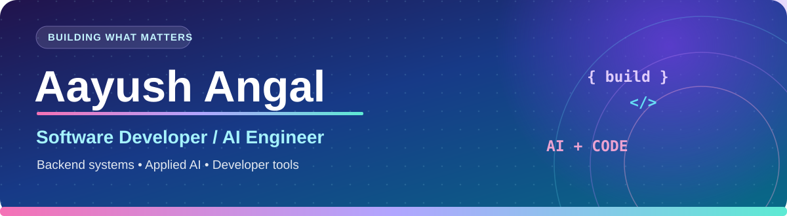

  
    
  
  
    
  <strong>Backend Engineering &nbsp;·&nbsp; AI Systems &nbsp;·&nbsp; Full-Stack Development</strong>

## 👋 About me

I'm an Electronics & Telecommunication Engineering student at **PICT, Pune**, interested in building software that solves real problems—from backend APIs and databases to full-stack products and AI-assisted workflows.

- 💼 **Experience:** AI/ML Engineering Intern at **Prorigo Software**.
- 🧩 **Interests:** Software architecture, API development, applied AI, and engineering reliable systems.
- 🎨 **Beyond coding:** Volleyball and painting.

## 🌈 Tech stack

  

**Backend:** FastAPI · REST APIs · NestJS · Authentication & RBAC · Pydantic  
**AI:** LangChain · LangGraph · LlamaIndex · RAG · Qdrant · Local LLMs  
**Data & tools:** PostgreSQL · Supabase · SQL · Git · Azure DevOps · Docker

## 🚀 Featured projects

### 🩷 Medico.ai — AI-Assisted Clinical Triage

A full-stack healthcare engineering project that brings together **patient intake, multi-turn AI-assisted triage, and doctor-facing case review** in one workflow. The goal is to help organize information for clinical review—not to replace a medical professional.

- Built a **Next.js patient-facing interface** with conversational symptom intake and case visibility.
- Developed a **FastAPI AI service** that guides multi-step questioning and produces structured urgency assessments and case summaries.
- Used a **NestJS backend** for JWT-based authentication, application APIs, and coordination with **Supabase/PostgreSQL** for persistence.
- Integrated **local LLM inference with Ollama** to explore privacy-conscious AI processing.

`Next.js` `NestJS` `FastAPI` `Ollama` `PostgreSQL` `AI Triage`

*Private repository · Project details available on request. Experimental software, not a clinically validated diagnostic tool.*

### 💜 ResearchSync — Research Publication & Accreditation Platform

A full-stack institutional platform to reduce repetitive work in **research publication submission, metadata verification, approval, and accreditation reporting**.

- Designed a **PDF-to-structured-data workflow**, with document parsing via **Docling/PyMuPDF** and optional local AI enrichment.
- Supports a **human-in-the-loop review process** so extracted publication metadata can be verified and corrected before final submission.
- Uses **FastAPI, SQLAlchemy, and PostgreSQL** to support publication records, user roles, and administrative operations.
- Includes **React-based interfaces** for faculty and administrators and **Excel reporting using OpenPyXL**.
- Organized the system into frontend, backend, database, and extraction layers for maintainability.

`React` `FastAPI` `PostgreSQL` `Supabase` `Docling` `OpenPyXL`

*Private repository · Project overview available on request.*

### 💚 [Library Management System — Library Operations Platform](https://github.com/Beast123-cmd/Library-Management-System)

A management application that models day-to-day library operations through **inventory control, member access, book borrowing, and administrative workflows**.

- Supports **role-based access** for administrators and members.
- Covers **catalog search, book availability, issuing and returning books**, and transaction history.
- Models business rules such as **due dates, overdue fines, and inventory updates**.
- Provides administrative features for book management and operational reporting.

`Database Design` `Authentication` `RBAC` `CRUD` `Business Logic`

### 💙 [Subscription Management — Recurring Subscription Organizer](https://github.com/Beast123-cmd/Subscription-management)

A practical application centered on **organizing and managing recurring subscriptions** through a straightforward user experience.

- Focuses on making subscription information easier to **track and maintain**.
- Explores building clear, user-oriented **application workflows** for everyday financial organization.
- Emphasizes modular product development and a maintainable codebase.

`Full-Stack Development` `Product Workflows` `Application Architecture`

## 📊 GitHub activity

  
  

---

  <strong>💜 Building useful products with thoughtful engineering.</strong> 
  Explore my public repositories or connect to learn more about my work.

