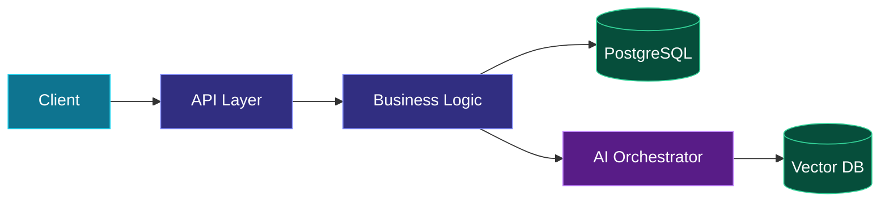

<div align="center">


<br/>

<a href="https://aayush-portfolio-svud.onrender.com/">
  
</a>
<a href="https://github.com/Beast123-cmd?tab=repositories">
  
</a>

<br/><br/>


<br/>

**`BACKEND ENGINEERING`** &nbsp;·&nbsp; **`SYSTEM DESIGN`** &nbsp;·&nbsp; **`AGENTIC AI`** &nbsp;·&nbsp; **`FULL-STACK`**

</div>

---

## 01 / About Me

```yaml
developer:
  name: Aayush Angal
  education: PICT, Pune
  experience: AI/ML Engineering Intern @ Prorigo Software
  focus:
    - Backend & System Architecture
    - AI Agents & LLM Applications
    - Full-Stack Engineering
  interests: [Distributed Systems, APIs, Databases, Applied AI]
  beyond_code: [Volleyball, Painting]
```

I build **backend-driven applications and AI-powered systems**, focusing on reliable APIs, scalable architecture, and software that solves real problems.

---

## 02 / Engineering Toolkit

<div align="center">

### Languages


### Frameworks & Backend


### Databases & Infrastructure


### Development Tools


</div>

<br/>

| Engineering Area | Technologies |
|:---|:---|
| **Backend** | FastAPI, REST APIs, Pydantic, PyTest |
| **AI Engineering** | LangChain, LangGraph, LlamaIndex, RAG |
| **Databases** | PostgreSQL, MySQL, Supabase, Qdrant |
| **Architecture** | API Design, Data Modeling, Authentication, System Design |
| **Infrastructure** | Docker, Git, GitHub, Azure DevOps |

---

## 03 / System Architecture Mindset

<div align="center">

**Designing systems from the interface to the intelligence layer**

</div>



<div align="center">
<sub>Conceptual architecture representing my engineering focus.</sub>
</div>

---

## 04 / Featured Projects

<table>
<tr>
<td width="50%" valign="top">

### 🩺 Medico.ai

**AI-Assisted Healthcare Platform**

Multi-agent clinical assistance, patient workflows, symptom analysis, and structured case reports.

**Stack:** `Next.js` `FastAPI` `LangGraph`

<a href="https://github.com/search?q=owner%3ABeast123-cmd+Medico&type=repositories">
  
</a>

</td>
<td width="50%" valign="top">

### 🔬 ResearchSync

**Research Publication Intelligence**

Automates publication PDF extraction, metadata verification, faculty review, and accreditation reporting.

**Stack:** `Next.js` `FastAPI` `PostgreSQL`

<a href="https://github.com/Beast123-cmd/ResearchSync">
  
</a>

</td>
</tr>
<tr>
<td width="50%" valign="top">

### 📊 Elevra.ai

**Student Analytics & Success Platform**

Transforms academic and engagement data into student performance insights and risk indicators.

**Focus:** `Analytics` `AI` `Full-Stack`

<a href="https://elevra.engimind.cloud/">
  
</a>

</td>
<td width="50%" valign="top">

### 📚 Library Management

**Library Operations Platform**

Manages inventory, member access, book issuing, returns, and borrowing transactions.

**Focus:** `Database` `RBAC` `Backend`

<a href="https://github.com/Beast123-cmd/Library-Management-System">
  
</a>

</td>
</tr>
<tr>
<td colspan="2" align="center">

### 💳 Subscription Management

**Recurring Subscription Organizer**

A full-stack application for organizing and tracking recurring subscriptions.

**Focus:** `Full-Stack` `Application Architecture`

<a href="https://github.com/Beast123-cmd/Subscription-management">
  
</a>

</td>
</tr>
</table>

---

## 05 / Professional Experience

### AI/ML Engineering Intern — Prorigo Software

Worked on enterprise AI applications and backend engineering, including **API development, OData/MCP integrations, knowledge systems, and testing**.

`Python` `FastAPI` `REST APIs` `OData` `MCP` `PyTest`

---

## 06 / GitHub Analytics

<div align="center">


<br/><br/>


</div>

---

## 07 / Engineering Interests

<table>
<tr>
<td width="50%" valign="top">

### System Design

- Backend Architecture
- Distributed Systems
- Database Design
- Caching & Concurrency
- API Reliability

</td>
<td width="50%" valign="top">

### AI Engineering

- Agent Orchestration
- RAG & Vector Search
- LLM Integration
- Document Intelligence
- Intelligent Workflows

</td>
</tr>
</table>

---

<div align="center">

### Engineering Systems. Building Intelligence. Solving Problems.

<a href="https://aayush-portfolio-svud.onrender.com/">
  
</a>

<br/><br/>

<sub>Software Engineering × System Design × Artificial Intelligence</sub>

</div>
